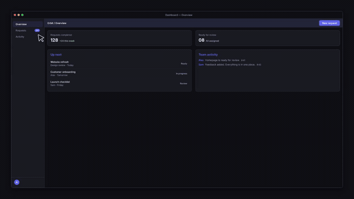

# remotion-cinematic

**Turn product screenshots, recordings, or structured app data into a product demo video.** Start with a 15-second feature announcement, a 30-second walkthrough, or a 20-second before/after story. Customize in Remotion Studio and export an MP4 in landscape, portrait, or square format.

[](https://github.com/codeverbojan/remotion-cinematic/actions/workflows/ci.yml)



[See the examples and settings](examples/README.md) · [Download the example videos](https://github.com/codeverbojan/remotion-cinematic/releases/tag/v0.2.0) · [First video tutorial](docs/GETTING-STARTED.md) · [Get help](https://github.com/codeverbojan/remotion-cinematic/issues/new?template=help.yml)

## Make your first video

Requires Node.js 20+ and npm; use macOS 15+ or a supported Linux/Windows rendering environment. No API key is needed for the included examples or your own screenshots.

```bash
git clone https://github.com/codeverbojan/remotion-cinematic.git my-video
cd my-video
npm ci
npm run project -- --load=examples/feature.json
npm run studio
```

Open the address printed by Studio. Edit the brand, headline and CTA in the props panel; double-click text or drag windows in the preview. Changes save to `src/Root.tsx`. Stop Studio when finished, then render those saved edits:

```bash
npm run build
```

Your video is at `out/video.mp4`. The first render may download Chrome; bundled Google fonts need network access. Render jobs use one worker by default.

To use your product, place images in `public/screenshots/`, then create and load a project:

```bash
npm run init-video -- --preset=feature --format=portrait --name="Acme" --screenshots=screenshots/dashboard.png,screenshots/details.png,screenshots/activity.png --out=video.json
npm run project -- --load=video.json
npm run studio
```

Loading a project backs up the previous settings to `src/Root.tsx.bak`. `init-video` refuses to overwrite an existing JSON file. See [recordings, cropping, logos and imports](docs/CUSTOMIZATION.md).

## Choose a starting point

| Preset | Duration | Example | Use it for |
|---|---:|---|---|
| `feature` | 15 seconds | [Orbit · landscape](examples/feature.json) | A product or feature announcement |
| `walkthrough` | 30 seconds | [Tandem · portrait](examples/walkthrough.json) | Problem, product, features and CTA |
| `before-after` | 20 seconds | [Relay · square](examples/before-after.json) | A scattered workflow becoming organized |

Every preset supports 1920×1080, 1080×1920 and 1080×1080 at 30 fps. Portrait and square presets rearrange product windows. Example brands and data are fictional.

## What you can customize

- **Product content:** screenshots and muted screen recordings, or editable React UI from a validated JSON descriptor. Feature windows can use separate media.
- **Motion:** scene order, duration, overlap, directions, backgrounds, window geometry and cursor paths. Cursor actions stay attached to their scenes when reordered.
- **Brand:** colors, bundled/system fonts, logo, headlines and CTA. Text fitting and content warnings help catch overly long copy and clipped actions.
- **Sound:** independent music and SFX controls. The SFX master covers cursor clicks, window entrances and transitions.
- **Editing:** drag and resize windows, edit text inline, adjust cursor waypoints, and add windows to the current scene. Save errors remain visible.

Screenshots and recordings preserve your real UI. Descriptor imports reconstruct supported components; they are not pixel-perfect design converters. Generic cursor clicks provide press feedback; custom tab changes or workflows need explicit UI state keyframes. See [scene authoring](docs/SCENES.md).

## Commands

| Command | Result |
|---|---|
| `npm run studio` | Edit the current saved project |
| `npm run build` | Export current saved edits to `out/video.mp4` |
| `npm run build -- --props=examples/feature.json` | Render a JSON project directly |
| `npm run init-video -- --help` | Create a customized preset |
| `npm run project -- --export=my-edits.json` | Export saved Studio settings |
| `npm run import -- --json=descriptor.json --inject` | Validate and load an app descriptor |
| `npm run check` | Typecheck and run regression tests |
| `npm run verify:render` | Render a frame from each example |
| `npm run verify:render -- --videos` | Export all three examples to `out/verification/` |

Use `project --load` before editing. The `--props` flag is useful for direct rendering, but its overrides can hide changes saved in Studio.

## Learn and contribute

[Getting started](docs/GETTING-STARTED.md) · [Customization](docs/CUSTOMIZATION.md) · [Scenes](docs/SCENES.md) · [Engine reference](docs/ENGINE.md) · [Roadmap](ROADMAP.md) · [Changelog](CHANGELOG.md)

[Share a video you made](https://github.com/codeverbojan/remotion-cinematic/issues/new?template=showcase.yml), [report a bug](https://github.com/codeverbojan/remotion-cinematic/issues/new?template=bug_report.md), or read [the contribution guide](CONTRIBUTING.md). AI coding tools can use the project notes in `.claude/CLAUDE.md`; they are optional for making a video.

Built by [Bojan Josifoski](https://bojanjosifoski.com) while building [SampleHQ](https://samplehq.io).

MIT for this repository. Remotion has [its own licensing terms](https://www.remotion.dev/license).
