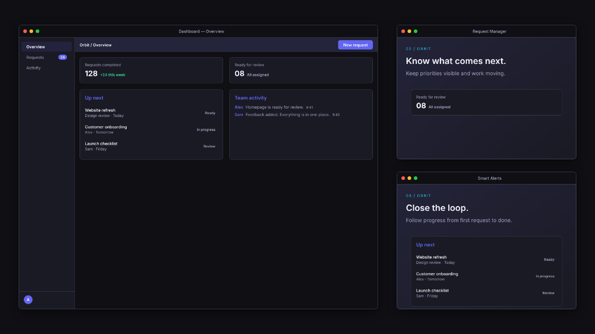
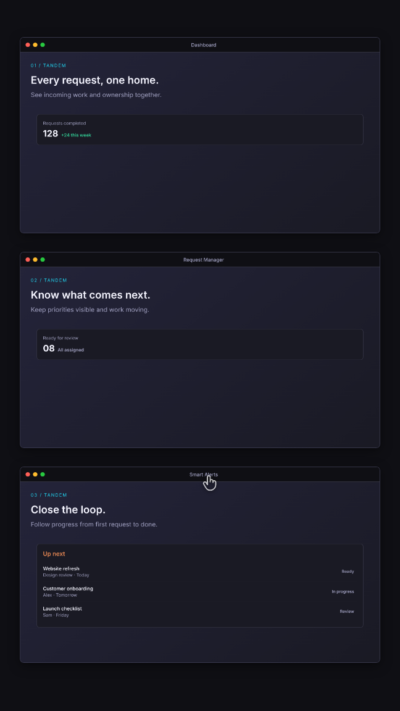
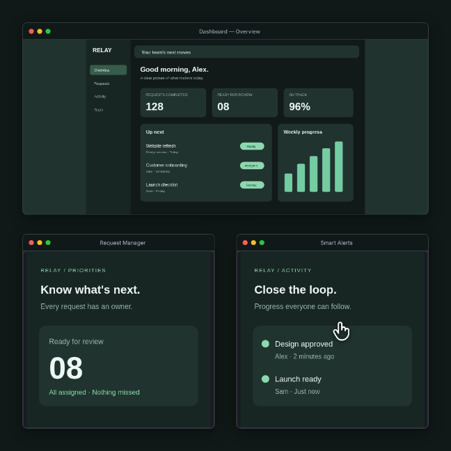

# Finished example projects

These examples use fictional products and sample data. Each JSON includes the full saved settings, so the export can be reproduced without an API key.

| Project settings | Video download | Format | Length | Content |
|---|---|---|---:|---|
| [Orbit feature announcement](feature.json) | [MP4](https://github.com/codeverbojan/remotion-cinematic/releases/download/v0.2.0/feature.mp4) | Landscape | 15s | Editable dashboard and focused feature cards |
| [Tandem walkthrough](walkthrough.json) | [MP4](https://github.com/codeverbojan/remotion-cinematic/releases/download/v0.2.0/walkthrough.mp4) | Portrait | 30s | Problem, reveal, features, resolution and CTA |
| [Relay before/after](before-after.json) | [MP4](https://github.com/codeverbojan/remotion-cinematic/releases/download/v0.2.0/before-after.mp4) | Square | 20s | Scattered work followed by actual SVG screenshot inputs |

The [v0.2.0 release](https://github.com/codeverbojan/remotion-cinematic/releases/tag/v0.2.0) includes these videos, matching JSON settings, preview images and SHA256 checksums. Downloaded videos use two-thirds resolution; rendering the project normally produces the full configured resolution.







## Render or edit

```bash
npm run build -- --props=examples/feature.json
# Or load it for editing, then render the saved changes:
npm run project -- --load=examples/feature.json
npm run studio
```

`npm run verify:render -- --videos` produces all three MP4s in `out/verification/`, with one worker and a shared browser that closes on completion. The verification videos are scaled to two-thirds resolution to keep review inexpensive; `npm run build` exports full resolution.

The Relay screenshots live in `public/screenshots/`. Replace them with your real UI. Use separate feature details to avoid repeating a small, unreadable dashboard in every window.

After a full export, `node scripts/make-preview.mjs` uses standard FFmpeg from PATH (or `FFMPEG_PATH`) to create a compact finished-video GIF in `out/verification/`; review it and the PNGs before copying them into `docs/assets/`. CI uploads these outputs as an artifact.

To regenerate these JSON fixtures after changing preset code, run `npm run examples`. Re-render and review the images before updating the gallery.
